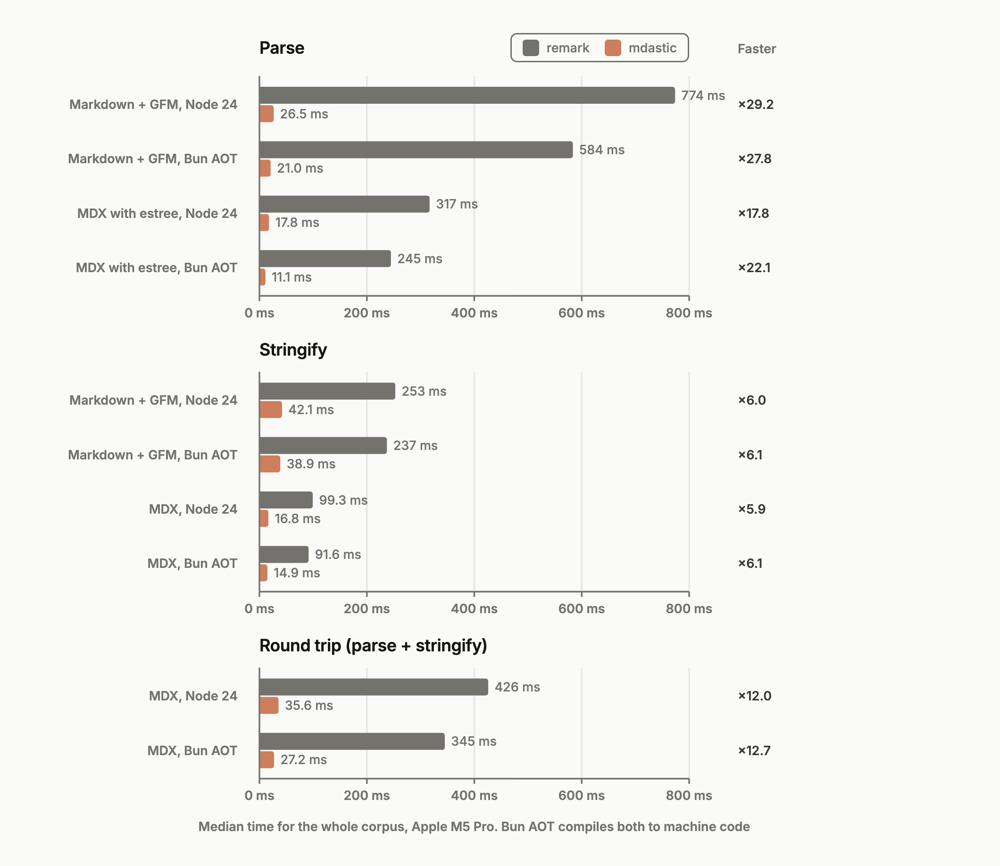
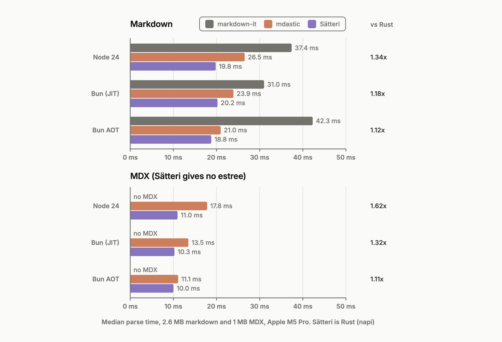
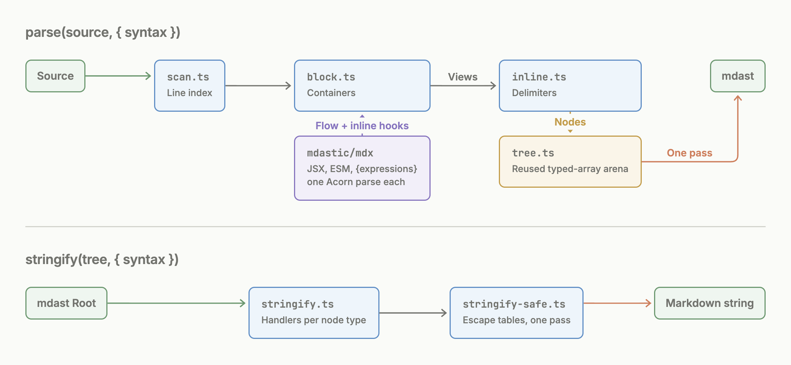

<div align='center' class='hidden'>
    <br/>
    <br/>
    <h3>mdastic</h3>
    <p>Markdown and MDX parser that outputs the exact remark mdast, 18 to 29x faster.</p>
    <br/>
    <br/>
</div>

mdastic is **one package** for parsing and serializing markdown. It gives the **same mdast as remark**, byte for byte: positions, `data.estree` and MDX errors included. MDX, GFM and frontmatter are built in. It is written in plain TypeScript, so it runs in Node, Bun, Workers and the browser.

```ts
import { parse, stringify, visit } from 'mdastic'
import { mdx } from 'mdastic/mdx'
import { gfm } from 'mdastic/gfm'
import { frontmatter } from 'mdastic/frontmatter'

const syntax = [mdx(), gfm(), frontmatter(['yaml'])]

const tree = parse(source, { syntax }) // Root | MdxParseError, never throws
if (tree instanceof Error) throw tree

visit(tree, 'heading', (node) => {
  node.depth // node is typed as Heading
})

const markdown = stringify(tree, { syntax }) // same string as remark-stringify
```

## Features

- **Exact remark output.** 9,854 of 9,854 conformance fixtures match the real remark stack, including positions and estree.
- **Fast.** 29x faster than remark on markdown, 18x on MDX, 6x on stringify. Faster than markdown-it. Compiled with Bun AOT, within 1.1x of native Rust.
- **One syntax list.** The same `syntax` array drives `parse` and `stringify`. No separate micromark, from-markdown and to-markdown extension arrays.
- **MDX built in.** JSX, ESM and `{expressions}` with `data.estree`. Only `mdastic/mdx` imports Acorn, so plain markdown bundles stay small.
- **Streaming parsing.** `createStreamParser()` parses LLM output as it arrives. Closed blocks are not parsed again and keep object identity, and every result still equals `parse(text)`.
- **Errors as values.** `parse` returns `MdxParseError` instead of throwing. It has the same fields as micromark's `VFileMessage`.
- **Typed helpers.** `visit` narrows the node type from the filter. `NodeOf<'heading'>` replaces `Extract<RootContent, { type: 'heading' }>`.
- **Small dependency tree.** Only `acorn` and `acorn-jsx` at runtime, both for MDX. No unified, micromark or vfile.

## Install

```bash
npm install mdastic
```

> [!WARNING]
> mdastic is **experimental and unstable**. It is on version 0.x, and any release can break the API. Pin the exact version.

## Benchmarks

Real documents, each parsed on its own, like a docs site build. 342 markdown docs (2.6 MB of READMEs and Mintlify docs) and 523 MDX docs (1 MB of Holocron docs). Median of 15 runs after warmup.



| Task | remark, Node 24 | mdastic, Node 24 | Faster | remark, Bun AOT | mdastic, Bun AOT | Faster |
| --- | ---: | ---: | ---: | ---: | ---: | ---: |
| Parse markdown + GFM | 774 ms | **26.5 ms** | 29.2x | 584 ms | **21.0 ms** | 27.8x |
| Parse MDX with estree | 317 ms | **17.8 ms** | 17.8x | 245 ms | **11.1 ms** | 22.1x |
| Stringify markdown + GFM | 253 ms | **42.1 ms** | 6.0x | 237 ms | **38.9 ms** | 6.1x |
| Stringify MDX | 99.3 ms | **16.8 ms** | 5.9x | 91.6 ms | **14.9 ms** | 6.1x |
| Round trip MDX | 426 ms | **35.6 ms** | 12.0x | 345 ms | **27.2 ms** | 12.7x |

### Against other fast parsers

mdastic is **faster than markdown-it** on every runtime. markdown-it only emits a token list and builds no tree. Sätteri is a native Rust addon (napi) and gives no `data.estree` for MDX.

Compiled with **Bun AOT**, mdastic is **1.1x behind Sätteri**: 21.0 ms vs 18.8 ms on markdown, 11.1 ms vs 10.0 ms on MDX. On Node 24 the gap is 1.3x on markdown and 1.6x on MDX.



| Runtime | Corpus | markdown-it 14 | mdastic | Sätteri 0.10.5 | mdastic vs Sätteri |
| --- | --- | ---: | ---: | ---: | ---: |
| Node 24 | Markdown + GFM | 37.4 ms | **26.5 ms** | 19.8 ms | 1.34x slower |
| Node 24 | MDX | no MDX | **17.8 ms** | 11.0 ms | 1.62x slower |
| Bun (JIT) | Markdown + GFM | 31.0 ms | **23.9 ms** | 20.2 ms | 1.18x slower |
| Bun (JIT) | MDX | no MDX | **13.5 ms** | 10.3 ms | 1.32x slower |
| Bun AOT | Markdown + GFM | 42.3 ms | **21.0 ms** | 18.8 ms | 1.12x slower |
| Bun AOT | MDX | no MDX | **11.1 ms** | 10.0 ms | 1.11x slower |

Node 24.22.1 and Bun 1.4.4 canary (`11c367163`) on an Apple M5 Pro, median of 3 runs. Run it yourself:

```bash
pnpm install
pnpm --dir mdastic build
cd conformance && NODE_ENV=production pnpm exec tsx src/bench.ts
```

### Bun AOT

`bun build --compile --aot` ([oven-sh/bun#45631](https://github.com/oven-sh/bun/pull/45631)) compiles TypeScript to **machine code** at build time, with no JIT. The benchmark builds into one executable, so remark, markdown-it and mdastic are all compiled. Sätteri stays native.

```bash
bun upgrade --canary  # --aot needs Bun 1.4.4 canary or later
cd conformance
bun build --compile --aot --compile-in-place --production \
  --define 'process.env.NODE_ENV="production"' src/bench.ts --outfile ../tmp/bench-aot
../tmp/bench-aot
```

AOT makes mdastic parse **1.3x faster** on markdown and **1.6x faster** on MDX than Node 24. Stringify gains less: 1.1x over Node, and plain `bun` (JIT) is faster at 33.3 ms. The AOT build gives byte-identical trees and strings on the whole corpus.

### Bundle size

Minified with `bun build --target browser`. Most of the MDX size is Acorn.

| Syntax | remark | mdastic |
| --- | ---: | ---: |
| Markdown + GFM + frontmatter | 157 KB (44.5 KB gzip) | **126 KB (43.7 KB gzip)** |
| Plus MDX | 448 KB (129 KB gzip) | **380 KB (118 KB gzip)** |

## API

### `parse(source, options)`

```ts
function parse(source: string, options?: {
  syntax?: Syntax[]     // [mdx(), gfm(), frontmatter()]
  positions?: boolean   // default true; false skips `position` on every node
}): Root | MdxParseError
```

Only MDX syntax can fail. The error is **returned**, so check it with `instanceof Error`:

```ts
const tree = parse('<Card title={1 +}>', { syntax: [mdx()] })
if (tree instanceof MdxParseError) {
  tree.reason // 'Could not parse expression with acorn'
  tree.line   // 1
  tree.ruleId // 'acorn'
}
```

### `createStreamParser(options)`

Parse text that grows at the end, like an LLM response. Pass the **whole text so far** on every chunk:

```ts
import { createStreamParser } from 'mdastic'

const parser = createStreamParser({ syntax: [mdx(), gfm()] })
let text = ''
for await (const chunk of response) {
  text += chunk
  const tree = parser.parse(text) // same tree as parse(text)
  if (tree instanceof Error) continue // incomplete MDX, keep the last good tree
  render(tree)
}
```

A top-level block followed by a blank line and a complete line can no longer change. The parser keeps those blocks and parses only the text after them. They are the **same objects** in every result, so a renderer can skip them:

```tsx
import { memo, useMemo } from 'react'
import { createStreamParser, type RootContent } from 'mdastic'

// renderNode is your mdast renderer, for example safe-mdx
const Block = memo(({ node }: { node: RootContent }) => renderNode(node))

function StreamingAnswer({ text }: { text: string }) {
  const parser = useMemo(() => createStreamParser({ syntax: [gfm()] }), [])
  const tree = parser.parse(text)
  if (tree instanceof Error) return null
  return tree.children.map((node, index) => <Block key={index} node={node} />)
}
```

#### How it works

It is a cache over `parse`, not a different parser. After each call it finds the last **cut**: a line where every block before it is final. The next call parses only from the cut and puts the cached blocks in front.

```
# Title⏎                     ┐
⏎                            │ cached blocks: same objects, never parsed again
Closed paragraph.⏎           ┘
⏎                       ◄─── cut, the parser starts here on the next call
| a | b |⏎                   ┐
| - | - |⏎                   │ tail: parsed on every call
| 1 | 2                      ┘ still growing
```

A cut is placed before a block only when appended text can no longer change what came before:

- **A blank line** separates the blocks. Without it, `foo⏎<A⏎/>` is a paragraph and a JSX element until ` x` arrives after `/>`, then it is one paragraph.
- **The first line of the next block is complete.** `1. a⏎⏎1` is a list and a paragraph until `.` arrives, then it is one list.
- **Neither block is indented code,** and no frontmatter fence is still open at the start. Both carry parser state across blank lines.

If the text up to the end of that complete line changes, the cache is dropped and the parser starts over. Positions, `data.estree` and errors are computed against the whole text, so they never need shifting.

Tests stream every conformance fixture (character by character up to 400 characters, in 40 chunks above) and compare each result with `parse`. Things to know:

- **Do not mutate** returned trees. Reused blocks are shared between results. Copy before you transform (safe-mdx's `markAndUnravel` mutates).
- **Link and footnote definitions** and **MDX imports** apply to the whole document. Once a document has one, each call parses all text again.
- **One big block** is never reused: an answer that is a single list, blockquote or JSX wrapper is parsed in full each time.
- **Any edit** is detected, for example a regenerated message. The parser starts over.

Streaming each document in 32-character chunks, parsing the text so far after every chunk:

| Corpus | `parse` every chunk | `createStreamParser` |
| --- | ---: | ---: |
| READMEs, 2 MB (most have link definitions) | 115 µs per chunk | **35 µs** (3.3x) |
| Holocron MDX docs, 1 MB | 55 µs per chunk | **20 µs** (2.7x) |
| Markdown over 16 KB, no definitions | 123 µs per chunk | **12 µs** (10x) |

Run `cd conformance && NODE_ENV=production pnpm exec tsx ../scripts/bench-stream.ts`. A runnable example is in [`mdastic/examples/streaming.ts`](mdastic/examples/streaming.ts).

### `stringify(tree, options)`

Gives the same string as `mdast-util-to-markdown` with the matching extensions. It takes the same options: `bullet`, `emphasis`, `strong`, `fence`, `rule`, `listItemIndent`, `setext`, `closeAtx`, `handlers`, `join`, `unsafe` and the rest.

```ts
stringify(tree, { syntax: [gfm()], bullet: '-', emphasis: '_' })
```

### Syntax

Each syntax is a subpath export. Pass the same list to `parse` and `stringify`.

| Import | Adds | Options |
| --- | --- | --- |
| `gfm()` from `mdastic/gfm` | tables, strikethrough, footnotes, task lists, autolink literals | `singleTilde` (default `true`) |
| `mdx()` from `mdastic/mdx` | JSX, ESM, `{expressions}` | `estree` (default `true`) attaches `data.estree` |
| `frontmatter()` from `mdastic/frontmatter` | `---` yaml and `+++` toml blocks | `['yaml', 'toml']` |
| `headingId()` from `mdastic/heading-id` | `{#custom-id}` text nodes, also outside headings | none |
| `math()` from `mdastic/math` | `$$` math blocks and `$x$` inline math, like remark-math | `singleDollarTextMath` (default `true`) |

```ts
import { headingId } from 'mdastic/heading-id'

parse('# Title {#custom-id}', { syntax: [headingId()] })
```

**Heading IDs** emit `idString` nodes. Their positions cover the value, not the `{#` and `}` markers.
With MDX, valid IDs win over text expressions. MDX flow expressions still take priority, so a
standalone `{#id}` line fails. A failed ID attempt falls back to the ordinary MDX expression parser.

**Stringify difference:** `mdast-heading-id` has no to-markdown handler, so remark-stringify throws
on `idString`. mdastic writes `{#value}`, with character references where needed for a round trip.

### `remarkTransform(plugin, ...options)`

Run an existing **tree-only remark plugin**, without unified:

```ts
import { remarkTransform } from 'mdastic/remark'
import remarkSqueezeParagraphs from 'remark-squeeze-paragraphs'

const transform = remarkTransform(remarkSqueezeParagraphs)
const tree = parse(source)
if (tree instanceof Error) throw tree
await transform(tree)
```

Attachment receives a minimal processor with `data()`. Transforms can be synchronous, return a
Promise, or use `next(error?)`. Pass your own file as the second argument, or use the default file
with `data`, `messages` and `message()`. Plugins that add parser or serializer extensions fail at
attachment. Use the built-in syntax descriptors instead.

### `visit(tree, filter?, visitor)`

Same semantics as `unist-util-visit`: depth first, preorder. The filter narrows the node type.

```ts
import { visit, SKIP, EXIT } from 'mdastic'

visit(tree, ['link', 'image'], (node, index, parent) => {
  node.url // Link | Image
})

visit(tree, (node, index, parent) => {
  if (node.type === 'blockquote') return SKIP // skip its children
  if (node.type === 'delete' && parent && index !== undefined) {
    parent.children.splice(index, 1, ...node.children)
    return index // visit the sibling now at this index
  }
  if (node.type === 'thematicBreak') return EXIT // stop the walk
})
```

### `toString(node)`

Plain text of a node, the same as `mdast-util-to-string`. Image `alt` and html values are included.

### Types

Every node type is exported from `mdastic`: core mdast, GFM, MDX and frontmatter nodes.

```ts
import type { Root, Nodes, Parents, NodeOf, MdxJsxFlowElement } from 'mdastic'

type Heading = NodeOf<'heading'>
```

## How it works

remark is slow because micromark runs each character through a state closure, creates an event object per token, backtracks failed attempts and builds the tree in a second pass. MDX calls Acorn at every `}` until a parse succeeds.

mdastic keeps the same rules and changes the data layout.



```
source ──► scan.ts ──► block.ts ──► deferred inline.ts ──► autolink.ts ──► tree.ts ──► mdast
              │            │                     ▲                            ▲
              │            └─► definitions ──────┘                            │
              └─► line index (Int32Array), UTF-16 positions ──────────────────┘
```

- **Typed-array arena.** Node kinds, offsets and links live in reused typed arrays. The mdast objects are built once at the end, in one pass.
- **Deferred inline parsing.** Inline content is parsed after all blocks, so link references can come before their definitions.
- **Native search, few regexes.** The scanner jumps between syntax candidates with native string search instead of testing every character.
- **One Acorn parse per expression.** A JS-aware scanner predicts the closing `}`. Acorn parses once. If the guess is wrong, it falls back to micromark's method, so boundaries and errors stay the same.
- **Escape tables for stringify.** Escaping rules are compiled once per syntax set and applied in one pass over each text.

## Conformance

The **real remark stack is the oracle.** `conformance/` pins `remark`, `micromark`, `mdast-util-*` and their extensions. Every fixture is parsed by both, and the full JSON trees are compared.

```
 upstream test suites ──► 9,854 inputs ──┬──► remark (pinned) ──► mdast JSON ──┐
                                         │                                     ├──► deep equal
                                         └──► mdastic ──────────► mdast JSON ──┘
                                                                  positions, estree, errors
```

| Source | Fixtures |
| --- | ---: |
| CommonMark spec | 652 |
| GFM spec | 671 |
| markdown-rs tests | 1,693 |
| remark, micromark and mdast-util suites | 1,617 |
| Sätteri tests and fuzz regressions | 3,816 |
| mdx-js and mdxjs-rs tests | 243 |
| Real documents (READMEs, Mintlify, Holocron) | 992 |
| Smoke and regressions | 12 |
| Heading IDs, upstream and edge cases | 158 |
| **Total, all pass** | **9,854** |

Stringify is checked with **838 tree-to-markdown cases** from mdast-util-to-markdown, every parse fixture the oracle can serialize, and 20,000 random trees. Heading IDs use separate round-trip tests. Full results per fixture file are in [docs/parser-conformance.md](docs/parser-conformance.md).

```bash
cd conformance
pnpm exec tsx src/report.ts parse   # pass rate per fixture file
pnpm exec vitest run                # full differential suite
```

## Limits

- **Deep nesting** can hit the JavaScript call stack limit, because containers and links still recurse.
- **No HTML output.** mdastic stops at mdast. Use `mdast-util-to-hast` for HTML.
- **No syntax plugins.** Only GFM, MDX, frontmatter, heading IDs and opt-in math. Directives and other micromark extensions are not supported.
- **Limited remark adapter.** Tree mutation plugins only. No processor `use()`, parsing, compilation or full vfile implementation.
- **Empty heading IDs.** The pinned micromark-heading-id oracle hangs on `{#}` outside MDX flow. mdastic emits an empty `idString`; this case is tested separately, not counted as oracle conformance.

## Repository layout

| Folder | What |
| --- | --- |
| `mdastic/` | The npm package |
| `conformance/` | Pinned remark oracle, fixtures, differential tests, benchmark |
| `scripts/` | Fixture extraction from upstream suites, table generators, parse benchmarks |
| `docs/` | Parser notes, conformance results, README figures |

## License

MIT. The generated entity and punctuation tables keep their upstream licenses.
